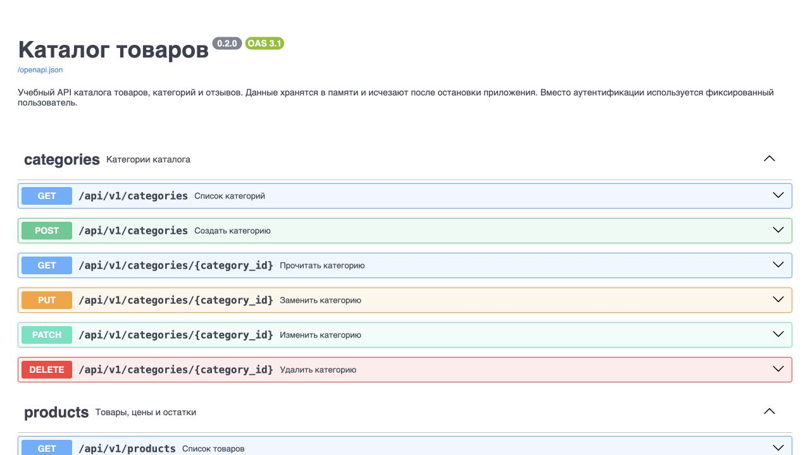
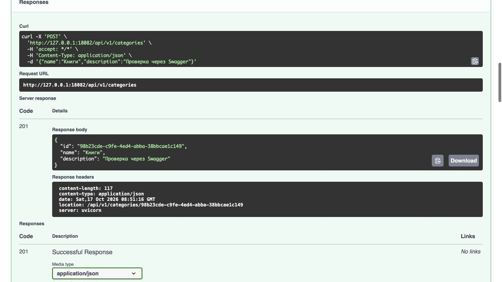

# Лабораторная работа 2. Контракт API, схемы и валидация

Тема: каталог товаров. Выполнены задачи 1–8. Задачи 9–10 не выполнялись.
Условие: [Part-2](https://git.digital.mephi.ru/Backend/Project/src/commit/7d0ee186c73d8ab39677218c066f06083296df04/Part-2/README.md).

## Окружение

Проверка выполнена 17 октября 2026 года на macOS arm64, Python 3.13.16,
FastAPI 0.115.14, Pydantic 2.14.1, uvicorn 0.54.0.
Зависимости зафиксированы в `uv.lock`.
Основное приложение запущено на `127.0.0.1:18082`, отдельный уязвимый пример —
на `127.0.0.1:18083`. Перед серией основное приложение запущено с пустыми словарями.
Ниже приведены реальные команды curl и их HTTP-ответы в порядке выполнения.
UUID и заголовок Date относятся к этому запуску; при повторении они будут другими.

```bash
uv sync --locked
uv run uvicorn app.main:app --host 127.0.0.1 --port 18082
# Во втором терминале, только для задачи 4:
uv run uvicorn app.vuln:app --host 127.0.0.1 --port 18083
```

## Задачи 1–2. Модель и CRUD

Диаграмма и таблица маршрутов приведены в [README](../README.md).
Используются Category, Product и Review. Связи: товар → категория, отзыв → товар.
Проверены все пять операций каждой сущности.

### Состояние приложения

```bash
curl -q -sS --max-time 10 -i -X GET http://127.0.0.1:18082/health
```

```http
HTTP/1.1 200 OK
date: Sat, 17 Oct 2026 08:50:57 GMT
server: uvicorn
content-length: 61
content-type: application/json

{"status":"ok","service":"product-catalog","version":"0.2.0"}
```

### Создание категории

```bash
curl -q -sS --max-time 10 -i -X POST http://127.0.0.1:18082/api/v1/categories -H 'Content-Type: application/json' -d '{"name":"  Книги  ","description":"Учебная литература"}'
```

```http
HTTP/1.1 201 Created
date: Sat, 17 Oct 2026 08:50:57 GMT
server: uvicorn
content-length: 117
content-type: application/json
location: /api/v1/categories/87bb7824-fcd9-40cd-9cf6-c055ffd7bfe6

{"id":"87bb7824-fcd9-40cd-9cf6-c055ffd7bfe6","name":"Книги","description":"Учебная литература"}
```

### Список категорий

```bash
curl -q -sS --max-time 10 -i -X GET http://127.0.0.1:18082/api/v1/categories
```

```http
HTTP/1.1 200 OK
date: Sat, 17 Oct 2026 08:50:57 GMT
server: uvicorn
content-length: 119
content-type: application/json

[{"id":"87bb7824-fcd9-40cd-9cf6-c055ffd7bfe6","name":"Книги","description":"Учебная литература"}]
```

### Чтение категории

```bash
curl -q -sS --max-time 10 -i -X GET http://127.0.0.1:18082/api/v1/categories/87bb7824-fcd9-40cd-9cf6-c055ffd7bfe6
```

```http
HTTP/1.1 200 OK
date: Sat, 17 Oct 2026 08:50:57 GMT
server: uvicorn
content-length: 117
content-type: application/json

{"id":"87bb7824-fcd9-40cd-9cf6-c055ffd7bfe6","name":"Книги","description":"Учебная литература"}
```

### Полная замена категории

```bash
curl -q -sS --max-time 10 -i -X PUT http://127.0.0.1:18082/api/v1/categories/87bb7824-fcd9-40cd-9cf6-c055ffd7bfe6 -H 'Content-Type: application/json' -d '{"name":"Книги"}'
```

```http
HTTP/1.1 200 OK
date: Sat, 17 Oct 2026 08:50:57 GMT
server: uvicorn
content-length: 84
content-type: application/json

{"id":"87bb7824-fcd9-40cd-9cf6-c055ffd7bfe6","name":"Книги","description":null}
```

### Создание товара

```bash
curl -q -sS --max-time 10 -i -X POST http://127.0.0.1:18082/api/v1/products -H 'Content-Type: application/json' -d '{"category_id":"87bb7824-fcd9-40cd-9cf6-c055ffd7bfe6","name":"Учебник Python","price":1000,"discount_price":800,"stock":10,"condition":"new"}'
```

```http
HTTP/1.1 201 Created
date: Sat, 17 Oct 2026 08:50:57 GMT
server: uvicorn
content-length: 247
content-type: application/json
location: /api/v1/products/0c74b064-0265-4f7a-8261-36d0d539f685

{"id":"0c74b064-0265-4f7a-8261-36d0d539f685","seller_id":"00000000-0000-0000-0000-000000000001","category_id":"87bb7824-fcd9-40cd-9cf6-c055ffd7bfe6","name":"Учебник Python","price":1000.0,"discount_price":800.0,"stock":10,"condition":"new"}
```

### Список товаров

```bash
curl -q -sS --max-time 10 -i -X GET http://127.0.0.1:18082/api/v1/products
```

```http
HTTP/1.1 200 OK
date: Sat, 17 Oct 2026 08:50:57 GMT
server: uvicorn
content-length: 249
content-type: application/json

[{"id":"0c74b064-0265-4f7a-8261-36d0d539f685","seller_id":"00000000-0000-0000-0000-000000000001","category_id":"87bb7824-fcd9-40cd-9cf6-c055ffd7bfe6","name":"Учебник Python","price":1000.0,"discount_price":800.0,"stock":10,"condition":"new"}]
```

### Чтение товара

```bash
curl -q -sS --max-time 10 -i -X GET http://127.0.0.1:18082/api/v1/products/0c74b064-0265-4f7a-8261-36d0d539f685
```

```http
HTTP/1.1 200 OK
date: Sat, 17 Oct 2026 08:50:57 GMT
server: uvicorn
content-length: 247
content-type: application/json

{"id":"0c74b064-0265-4f7a-8261-36d0d539f685","seller_id":"00000000-0000-0000-0000-000000000001","category_id":"87bb7824-fcd9-40cd-9cf6-c055ffd7bfe6","name":"Учебник Python","price":1000.0,"discount_price":800.0,"stock":10,"condition":"new"}
```

### Полная замена товара

```bash
curl -q -sS --max-time 10 -i -X PUT http://127.0.0.1:18082/api/v1/products/0c74b064-0265-4f7a-8261-36d0d539f685 -H 'Content-Type: application/json' -d '{"category_id":"87bb7824-fcd9-40cd-9cf6-c055ffd7bfe6","name":"Учебник Python","price":900,"stock":5}'
```

```http
HTTP/1.1 200 OK
date: Sat, 17 Oct 2026 08:50:57 GMT
server: uvicorn
content-length: 244
content-type: application/json

{"id":"0c74b064-0265-4f7a-8261-36d0d539f685","seller_id":"00000000-0000-0000-0000-000000000001","category_id":"87bb7824-fcd9-40cd-9cf6-c055ffd7bfe6","name":"Учебник Python","price":900.0,"discount_price":null,"stock":5,"condition":"new"}
```

### Создание отзыва

```bash
curl -q -sS --max-time 10 -i -X POST http://127.0.0.1:18082/api/v1/reviews -H 'Content-Type: application/json' -d '{"product_id":"0c74b064-0265-4f7a-8261-36d0d539f685","rating":5,"text":"Понятный учебник"}'
```

```http
HTTP/1.1 201 Created
date: Sat, 17 Oct 2026 08:50:57 GMT
server: uvicorn
content-length: 198
content-type: application/json
location: /api/v1/reviews/6db40110-8213-416e-9509-94069c97d018

{"id":"6db40110-8213-416e-9509-94069c97d018","user_id":"00000000-0000-0000-0000-000000000001","product_id":"0c74b064-0265-4f7a-8261-36d0d539f685","rating":5,"text":"Понятный учебник"}
```

### Список отзывов

```bash
curl -q -sS --max-time 10 -i -X GET http://127.0.0.1:18082/api/v1/reviews
```

```http
HTTP/1.1 200 OK
date: Sat, 17 Oct 2026 08:50:57 GMT
server: uvicorn
content-length: 200
content-type: application/json

[{"id":"6db40110-8213-416e-9509-94069c97d018","user_id":"00000000-0000-0000-0000-000000000001","product_id":"0c74b064-0265-4f7a-8261-36d0d539f685","rating":5,"text":"Понятный учебник"}]
```

### Чтение отзыва

```bash
curl -q -sS --max-time 10 -i -X GET http://127.0.0.1:18082/api/v1/reviews/6db40110-8213-416e-9509-94069c97d018
```

```http
HTTP/1.1 200 OK
date: Sat, 17 Oct 2026 08:50:57 GMT
server: uvicorn
content-length: 198
content-type: application/json

{"id":"6db40110-8213-416e-9509-94069c97d018","user_id":"00000000-0000-0000-0000-000000000001","product_id":"0c74b064-0265-4f7a-8261-36d0d539f685","rating":5,"text":"Понятный учебник"}
```

### Полная замена отзыва

```bash
curl -q -sS --max-time 10 -i -X PUT http://127.0.0.1:18082/api/v1/reviews/6db40110-8213-416e-9509-94069c97d018 -H 'Content-Type: application/json' -d '{"product_id":"0c74b064-0265-4f7a-8261-36d0d539f685","rating":4}'
```

```http
HTTP/1.1 200 OK
date: Sat, 17 Oct 2026 08:50:57 GMT
server: uvicorn
content-length: 169
content-type: application/json

{"id":"6db40110-8213-416e-9509-94069c97d018","user_id":"00000000-0000-0000-0000-000000000001","product_id":"0c74b064-0265-4f7a-8261-36d0d539f685","rating":4,"text":null}
```

При PUT пропущенные description, discount_price и text сброшены в null. UUID и владельцы сохранены. Удаление проверяется после PATCH ниже, чтобы сначала закончить операции над связанными объектами.

## Задача 3. Ограничения и валидаторы

### Лишнее поле

```bash
curl -q -sS --max-time 10 -i -X POST http://127.0.0.1:18082/api/v1/categories -H 'Content-Type: application/json' -d '{"name":"Книги","extra":"значение"}'
```

```http
HTTP/1.1 422 Unprocessable Content
date: Sat, 17 Oct 2026 08:50:57 GMT
server: uvicorn
content-length: 200
content-type: application/json

{"error":{"code":"validation_error","message":"Запрос не прошёл проверку","details":[{"field":"body.extra","rule":"extra_forbidden","message":"Extra inputs are not permitted"}]}}
```

### Название длиннее максимума 80

```bash
curl -q -sS --max-time 10 -i -X POST http://127.0.0.1:18082/api/v1/categories -H 'Content-Type: application/json' -d '{"name":"xxxxxxxxxxxxxxxxxxxxxxxxxxxxxxxxxxxxxxxxxxxxxxxxxxxxxxxxxxxxxxxxxxxxxxxxxxxxxxxxx"}'
```

```http
HTTP/1.1 422 Unprocessable Content
date: Sat, 17 Oct 2026 08:50:57 GMT
server: uvicorn
content-length: 209
content-type: application/json

{"error":{"code":"validation_error","message":"Запрос не прошёл проверку","details":[{"field":"body.name","rule":"string_too_long","message":"String should have at most 80 characters"}]}}
```

### Нарушение межполевого правила

```bash
curl -q -sS --max-time 10 -i -X POST http://127.0.0.1:18082/api/v1/products -H 'Content-Type: application/json' -d '{"category_id":"87bb7824-fcd9-40cd-9cf6-c055ffd7bfe6","name":"Учебник Python","price":1000,"discount_price":1200,"stock":10,"condition":"new"}'
```

```http
HTTP/1.1 422 Unprocessable Content
date: Sat, 17 Oct 2026 08:50:57 GMT
server: uvicorn
content-length: 262
content-type: application/json

{"error":{"code":"validation_error","message":"Запрос не прошёл проверку","details":[{"field":"body","rule":"value_error","message":"Value error, Цена со скидкой не должна превышать обычную цену"}]}}
```

Поле name очищается валидатором поля, что видно в первом ответе. Валидатор модели сравнивает discount_price и price и поднимает ValueError. FastAPI преобразует его в 422.

## Задача 4. Массовое присвоение

### Основное приложение отклоняет seller_id

```bash
curl -q -sS --max-time 10 -i -X POST http://127.0.0.1:18082/api/v1/products -H 'Content-Type: application/json' -d '{"category_id":"87bb7824-fcd9-40cd-9cf6-c055ffd7bfe6","name":"Учебник Python","price":1000,"discount_price":800,"stock":10,"condition":"new","seller_id":"00000000-0000-4000-8000-000000000099"}'
```

```http
HTTP/1.1 422 Unprocessable Content
date: Sat, 17 Oct 2026 08:50:57 GMT
server: uvicorn
content-length: 204
content-type: application/json

{"error":{"code":"validation_error","message":"Запрос не прошёл проверку","details":[{"field":"body.seller_id","rule":"extra_forbidden","message":"Extra inputs are not permitted"}]}}
```

### То же тело в уязвимом примере

```bash
curl -q -sS --max-time 10 -i -X POST http://127.0.0.1:18083/api/v1/products -H 'Content-Type: application/json' -d '{"category_id":"87bb7824-fcd9-40cd-9cf6-c055ffd7bfe6","name":"Учебник Python","price":1000,"discount_price":800,"stock":10,"condition":"new","seller_id":"00000000-0000-4000-8000-000000000099"}'
```

```http
HTTP/1.1 201 Created
date: Sat, 17 Oct 2026 08:50:57 GMT
server: uvicorn
content-length: 247
content-type: application/json
location: /api/v1/products/b37ba894-1ce9-4d6e-a043-74873a0e124f

{"id":"b37ba894-1ce9-4d6e-a043-74873a0e124f","seller_id":"00000000-0000-4000-8000-000000000099","category_id":"87bb7824-fcd9-40cd-9cf6-c055ffd7bfe6","name":"Учебник Python","price":1000.0,"discount_price":800.0,"stock":10,"condition":"new"}
```

В основном приложении продавец назначается сервером, а входная схема запрещает seller_id. Уязвимый обработчик принимает словарь и распаковывает его в Product, поэтому присланное значение заменяет владельца по умолчанию. В каталоге товаров это позволило бы создавать товар от имени другого продавца и подделывать его принадлежность. Уязвимый пример только возвращает модель и запускается отдельно.

## Задача 5. Swagger

В Swagger видны название, версия, описание, теги, операции, ошибки и отдельные схемы входа/выхода. Для всех входных схем есть примеры полей.





Второй скриншот снят после серии curl отдельным запросом через Try it out.

## Задача 6. Единые ошибки

### 422: неверное тело

```bash
curl -q -sS --max-time 10 -i -X POST http://127.0.0.1:18082/api/v1/reviews -H 'Content-Type: application/json' -d '{"product_id":"0c74b064-0265-4f7a-8261-36d0d539f685","rating":6}'
```

```http
HTTP/1.1 422 Unprocessable Content
date: Sat, 17 Oct 2026 08:50:57 GMT
server: uvicorn
content-length: 210
content-type: application/json

{"error":{"code":"validation_error","message":"Запрос не прошёл проверку","details":[{"field":"body.rating","rule":"less_than_equal","message":"Input should be less than or equal to 5"}]}}
```

### 404: отсутствующий UUID

```bash
curl -q -sS --max-time 10 -i -X GET http://127.0.0.1:18082/api/v1/products/00000000-0000-4000-8000-000000000099
```

```http
HTTP/1.1 404 Not Found
date: Sat, 17 Oct 2026 08:50:57 GMT
server: uvicorn
content-length: 84
content-type: application/json

{"error":{"code":"not_found","message":"Товар не найден","details":[]}}
```

### 422: неверный query-параметр

```bash
curl -q -sS --max-time 10 -i -X GET 'http://127.0.0.1:18082/api/v1/products?limit=wrong'
```

```http
HTTP/1.1 422 Unprocessable Content
date: Sat, 17 Oct 2026 08:50:57 GMT
server: uvicorn
content-length: 236
content-type: application/json

{"error":{"code":"validation_error","message":"Запрос не прошёл проверку","details":[{"field":"query.limit","rule":"int_parsing","message":"Input should be a valid integer, unable to parse string as an integer"}]}}
```

### 422: неверный UUID в пути

```bash
curl -q -sS --max-time 10 -i -X GET http://127.0.0.1:18082/api/v1/categories/not-a-uuid
```

```http
HTTP/1.1 422 Unprocessable Content
date: Sat, 17 Oct 2026 08:50:57 GMT
server: uvicorn
content-length: 236
content-type: application/json

{"error":{"code":"validation_error","message":"Запрос не прошёл проверку","details":[{"field":"path.category_id","rule":"uuid_parsing","message":"Input should be a valid UUID, invalid character: found `n` at 0"}]}}
```

### 422: некорректный JSON

```bash
curl -q -sS --max-time 10 -i -X POST http://127.0.0.1:18082/api/v1/categories -H 'Content-Type: application/json' -d '{"name":'
```

```http
HTTP/1.1 422 Unprocessable Content
date: Sat, 17 Oct 2026 08:50:57 GMT
server: uvicorn
content-length: 180
content-type: application/json

{"error":{"code":"validation_error","message":"Запрос не прошёл проверку","details":[{"field":"body.8","rule":"json_invalid","message":"JSON decode error"}]}}
```

### 404: неизвестный маршрут

```bash
curl -q -sS --max-time 10 -i -X GET http://127.0.0.1:18082/missing-route
```

```http
HTTP/1.1 404 Not Found
date: Sat, 17 Oct 2026 08:50:57 GMT
server: uvicorn
content-length: 65
content-type: application/json

{"error":{"code":"not_found","message":"Not Found","details":[]}}
```

### 405: неподдерживаемый метод

```bash
curl -q -sS --max-time 10 -i -X POST http://127.0.0.1:18082/api/v1/products/0c74b064-0265-4f7a-8261-36d0d539f685 -H 'Content-Type: application/json' -d '{}'
```

```http
HTTP/1.1 405 Method Not Allowed
date: Sat, 17 Oct 2026 08:50:57 GMT
server: uvicorn
allow: GET
content-length: 83
content-type: application/json

{"error":{"code":"method_not_allowed","message":"Method Not Allowed","details":[]}}
```

У ошибок одинаковый верхний ключ error и поля code, message, details. Для валидации details содержит поле и правило; для HTTP-ошибок он пуст. В записанных ответах нет стека, имён файлов проекта, input/ctx Pydantic или полного объекта исходного исключения. Заголовок Allow у 405 сохранён.

## Задача 7. PATCH

### Category: создание

```bash
curl -q -sS --max-time 10 -i -X POST http://127.0.0.1:18082/api/v1/categories -H 'Content-Type: application/json' -d '{"name":"Аксессуары","description":"Для техники"}'
```

```http
HTTP/1.1 201 Created
date: Sat, 17 Oct 2026 08:50:57 GMT
server: uvicorn
content-length: 113
content-type: application/json
location: /api/v1/categories/f9cf712a-1b8c-4af5-90f1-30d0f0b55e91

{"id":"f9cf712a-1b8c-4af5-90f1-30d0f0b55e91","name":"Аксессуары","description":"Для техники"}
```

### Category: изменение только name

```bash
curl -q -sS --max-time 10 -i -X PATCH http://127.0.0.1:18082/api/v1/categories/f9cf712a-1b8c-4af5-90f1-30d0f0b55e91 -H 'Content-Type: application/json' -d '{"name":"Техника"}'
```

```http
HTTP/1.1 200 OK
date: Sat, 17 Oct 2026 08:50:57 GMT
server: uvicorn
content-length: 107
content-type: application/json

{"id":"f9cf712a-1b8c-4af5-90f1-30d0f0b55e91","name":"Техника","description":"Для техники"}
```

### Category: чтение после PATCH

```bash
curl -q -sS --max-time 10 -i -X GET http://127.0.0.1:18082/api/v1/categories/f9cf712a-1b8c-4af5-90f1-30d0f0b55e91
```

```http
HTTP/1.1 200 OK
date: Sat, 17 Oct 2026 08:50:57 GMT
server: uvicorn
content-length: 107
content-type: application/json

{"id":"f9cf712a-1b8c-4af5-90f1-30d0f0b55e91","name":"Техника","description":"Для техники"}
```

### Review: создание

```bash
curl -q -sS --max-time 10 -i -X POST http://127.0.0.1:18082/api/v1/reviews -H 'Content-Type: application/json' -d '{"product_id":"0c74b064-0265-4f7a-8261-36d0d539f685","rating":5,"text":"Полезная книга"}'
```

```http
HTTP/1.1 201 Created
date: Sat, 17 Oct 2026 08:50:57 GMT
server: uvicorn
content-length: 194
content-type: application/json
location: /api/v1/reviews/76984486-a04b-47d0-bf3d-fcac12507921

{"id":"76984486-a04b-47d0-bf3d-fcac12507921","user_id":"00000000-0000-0000-0000-000000000001","product_id":"0c74b064-0265-4f7a-8261-36d0d539f685","rating":5,"text":"Полезная книга"}
```

### Review: изменение только rating

```bash
curl -q -sS --max-time 10 -i -X PATCH http://127.0.0.1:18082/api/v1/reviews/76984486-a04b-47d0-bf3d-fcac12507921 -H 'Content-Type: application/json' -d '{"rating":3}'
```

```http
HTTP/1.1 200 OK
date: Sat, 17 Oct 2026 08:50:57 GMT
server: uvicorn
content-length: 194
content-type: application/json

{"id":"76984486-a04b-47d0-bf3d-fcac12507921","user_id":"00000000-0000-0000-0000-000000000001","product_id":"0c74b064-0265-4f7a-8261-36d0d539f685","rating":3,"text":"Полезная книга"}
```

### Review: чтение после PATCH

```bash
curl -q -sS --max-time 10 -i -X GET http://127.0.0.1:18082/api/v1/reviews/76984486-a04b-47d0-bf3d-fcac12507921
```

```http
HTTP/1.1 200 OK
date: Sat, 17 Oct 2026 08:50:57 GMT
server: uvicorn
content-length: 194
content-type: application/json

{"id":"76984486-a04b-47d0-bf3d-fcac12507921","user_id":"00000000-0000-0000-0000-000000000001","product_id":"0c74b064-0265-4f7a-8261-36d0d539f685","rating":3,"text":"Полезная книга"}
```

### Явный null очищает текст

```bash
curl -q -sS --max-time 10 -i -X PATCH http://127.0.0.1:18082/api/v1/reviews/76984486-a04b-47d0-bf3d-fcac12507921 -H 'Content-Type: application/json' -d '{"text":null}'
```

```http
HTTP/1.1 200 OK
date: Sat, 17 Oct 2026 08:50:57 GMT
server: uvicorn
content-length: 169
content-type: application/json

{"id":"76984486-a04b-47d0-bf3d-fcac12507921","user_id":"00000000-0000-0000-0000-000000000001","product_id":"0c74b064-0265-4f7a-8261-36d0d539f685","rating":3,"text":null}
```

### Явный null не может заменить рейтинг

```bash
curl -q -sS --max-time 10 -i -X PATCH http://127.0.0.1:18082/api/v1/reviews/76984486-a04b-47d0-bf3d-fcac12507921 -H 'Content-Type: application/json' -d '{"rating":null}'
```

```http
HTTP/1.1 422 Unprocessable Content
date: Sat, 17 Oct 2026 08:50:57 GMT
server: uvicorn
content-length: 195
content-type: application/json

{"error":{"code":"validation_error","message":"Запрос не прошёл проверку","details":[{"field":"body.rating","rule":"int_type","message":"Input should be a valid integer"}]}}
```

В обеих тройках изменилось ровно одно переданное поле. UUID, связи, владелец и остальные данные сохранились. exclude_unset=True отличает отсутствующий text от явно переданного null.

## Завершение CRUD и проверка связей

### Нельзя удалить категорию с товаром

```bash
curl -q -sS --max-time 10 -i -X DELETE http://127.0.0.1:18082/api/v1/categories/87bb7824-fcd9-40cd-9cf6-c055ffd7bfe6
```

```http
HTTP/1.1 409 Conflict
date: Sat, 17 Oct 2026 08:50:57 GMT
server: uvicorn
content-length: 98
content-type: application/json

{"error":{"code":"conflict","message":"В категории есть товары","details":[]}}
```

### Нельзя удалить товар с отзывами

```bash
curl -q -sS --max-time 10 -i -X DELETE http://127.0.0.1:18082/api/v1/products/0c74b064-0265-4f7a-8261-36d0d539f685
```

```http
HTTP/1.1 409 Conflict
date: Sat, 17 Oct 2026 08:50:57 GMT
server: uvicorn
content-length: 92
content-type: application/json

{"error":{"code":"conflict","message":"У товара есть отзывы","details":[]}}
```

### Удаление первого отзыва

```bash
curl -q -sS --max-time 10 -i -X DELETE http://127.0.0.1:18082/api/v1/reviews/6db40110-8213-416e-9509-94069c97d018
```

```http
HTTP/1.1 204 No Content
date: Sat, 17 Oct 2026 08:50:57 GMT
server: uvicorn
```

### Удаление второго отзыва

```bash
curl -q -sS --max-time 10 -i -X DELETE http://127.0.0.1:18082/api/v1/reviews/76984486-a04b-47d0-bf3d-fcac12507921
```

```http
HTTP/1.1 204 No Content
date: Sat, 17 Oct 2026 08:50:57 GMT
server: uvicorn
```

### Удаление товара

```bash
curl -q -sS --max-time 10 -i -X DELETE http://127.0.0.1:18082/api/v1/products/0c74b064-0265-4f7a-8261-36d0d539f685
```

```http
HTTP/1.1 204 No Content
date: Sat, 17 Oct 2026 08:50:58 GMT
server: uvicorn
```

### Удаление категории

```bash
curl -q -sS --max-time 10 -i -X DELETE http://127.0.0.1:18082/api/v1/categories/87bb7824-fcd9-40cd-9cf6-c055ffd7bfe6
```

```http
HTTP/1.1 204 No Content
date: Sat, 17 Oct 2026 08:50:58 GMT
server: uvicorn
```

### Чтение удалённого товара

```bash
curl -q -sS --max-time 10 -i -X GET http://127.0.0.1:18082/api/v1/products/0c74b064-0265-4f7a-8261-36d0d539f685
```

```http
HTTP/1.1 404 Not Found
date: Sat, 17 Oct 2026 08:50:58 GMT
server: uvicorn
content-length: 84
content-type: application/json

{"error":{"code":"not_found","message":"Товар не найден","details":[]}}
```

Все успешные DELETE вернули 204 без тела.

## Задача 8. Пагинация, фильтры и сортировка

### Подготовка товара Gamma

```bash
curl -q -sS --max-time 10 -i -X POST http://127.0.0.1:18082/api/v1/products -H 'Content-Type: application/json' -d '{"category_id":"f9cf712a-1b8c-4af5-90f1-30d0f0b55e91","name":"Gamma","price":300,"stock":1,"condition":"new"}'
```

```http
HTTP/1.1 201 Created
date: Sat, 17 Oct 2026 08:50:58 GMT
server: uvicorn
content-length: 228
content-type: application/json
location: /api/v1/products/ba781693-1e12-4501-a900-f44762750f1e

{"id":"ba781693-1e12-4501-a900-f44762750f1e","seller_id":"00000000-0000-0000-0000-000000000001","category_id":"f9cf712a-1b8c-4af5-90f1-30d0f0b55e91","name":"Gamma","price":300.0,"discount_price":null,"stock":1,"condition":"new"}
```

### Подготовка товара Alpha

```bash
curl -q -sS --max-time 10 -i -X POST http://127.0.0.1:18082/api/v1/products -H 'Content-Type: application/json' -d '{"category_id":"f9cf712a-1b8c-4af5-90f1-30d0f0b55e91","name":"Alpha","price":100,"stock":1,"condition":"new"}'
```

```http
HTTP/1.1 201 Created
date: Sat, 17 Oct 2026 08:50:58 GMT
server: uvicorn
content-length: 228
content-type: application/json
location: /api/v1/products/12ed85ce-4fa7-4d86-af61-c8a112e98df8

{"id":"12ed85ce-4fa7-4d86-af61-c8a112e98df8","seller_id":"00000000-0000-0000-0000-000000000001","category_id":"f9cf712a-1b8c-4af5-90f1-30d0f0b55e91","name":"Alpha","price":100.0,"discount_price":null,"stock":1,"condition":"new"}
```

### Подготовка товара Beta

```bash
curl -q -sS --max-time 10 -i -X POST http://127.0.0.1:18082/api/v1/products -H 'Content-Type: application/json' -d '{"category_id":"f9cf712a-1b8c-4af5-90f1-30d0f0b55e91","name":"Beta","price":200,"stock":1,"condition":"used"}'
```

```http
HTTP/1.1 201 Created
date: Sat, 17 Oct 2026 08:50:58 GMT
server: uvicorn
content-length: 228
content-type: application/json
location: /api/v1/products/52a69378-b837-4ca7-8b2b-e846412a0815

{"id":"52a69378-b837-4ca7-8b2b-e846412a0815","seller_id":"00000000-0000-0000-0000-000000000001","category_id":"f9cf712a-1b8c-4af5-90f1-30d0f0b55e91","name":"Beta","price":200.0,"discount_price":null,"stock":1,"condition":"used"}
```

### limit=0

```bash
curl -q -sS --max-time 10 -i -X GET 'http://127.0.0.1:18082/api/v1/products?limit=0'
```

```http
HTTP/1.1 422 Unprocessable Content
date: Sat, 17 Oct 2026 08:50:58 GMT
server: uvicorn
content-length: 216
content-type: application/json

{"error":{"code":"validation_error","message":"Запрос не прошёл проверку","details":[{"field":"query.limit","rule":"greater_than_equal","message":"Input should be greater than or equal to 1"}]}}
```

### limit=1000

```bash
curl -q -sS --max-time 10 -i -X GET 'http://127.0.0.1:18082/api/v1/products?limit=1000'
```

```http
HTTP/1.1 422 Unprocessable Content
date: Sat, 17 Oct 2026 08:50:58 GMT
server: uvicorn
content-length: 212
content-type: application/json

{"error":{"code":"validation_error","message":"Запрос не прошёл проверку","details":[{"field":"query.limit","rule":"less_than_equal","message":"Input should be less than or equal to 100"}]}}
```

### offset=-1

```bash
curl -q -sS --max-time 10 -i -X GET 'http://127.0.0.1:18082/api/v1/products?offset=-1'
```

```http
HTTP/1.1 422 Unprocessable Content
date: Sat, 17 Oct 2026 08:50:58 GMT
server: uvicorn
content-length: 217
content-type: application/json

{"error":{"code":"validation_error","message":"Запрос не прошёл проверку","details":[{"field":"query.offset","rule":"greater_than_equal","message":"Input should be greater than or equal to 0"}]}}
```

### Недопустимое sort_by

```bash
curl -q -sS --max-time 10 -i -X GET 'http://127.0.0.1:18082/api/v1/products?sort_by=seller_id'
```

```http
HTTP/1.1 422 Unprocessable Content
date: Sat, 17 Oct 2026 08:50:58 GMT
server: uvicorn
content-length: 204
content-type: application/json

{"error":{"code":"validation_error","message":"Запрос не прошёл проверку","details":[{"field":"query.sort_by","rule":"enum","message":"Input should be 'name', 'price' or 'stock'"}]}}
```

### Первая страница

```bash
curl -q -sS --max-time 10 -i -X GET 'http://127.0.0.1:18082/api/v1/products?sort_by=price&limit=2&offset=0'
```

```http
HTTP/1.1 200 OK
date: Sat, 17 Oct 2026 08:50:58 GMT
server: uvicorn
content-length: 459
content-type: application/json

[{"id":"12ed85ce-4fa7-4d86-af61-c8a112e98df8","seller_id":"00000000-0000-0000-0000-000000000001","category_id":"f9cf712a-1b8c-4af5-90f1-30d0f0b55e91","name":"Alpha","price":100.0,"discount_price":null,"stock":1,"condition":"new"},{"id":"52a69378-b837-4ca7-8b2b-e846412a0815","seller_id":"00000000-0000-0000-0000-000000000001","category_id":"f9cf712a-1b8c-4af5-90f1-30d0f0b55e91","name":"Beta","price":200.0,"discount_price":null,"stock":1,"condition":"used"}]
```

### Вторая страница

```bash
curl -q -sS --max-time 10 -i -X GET 'http://127.0.0.1:18082/api/v1/products?sort_by=price&limit=2&offset=2'
```

```http
HTTP/1.1 200 OK
date: Sat, 17 Oct 2026 08:50:58 GMT
server: uvicorn
content-length: 230
content-type: application/json

[{"id":"ba781693-1e12-4501-a900-f44762750f1e","seller_id":"00000000-0000-0000-0000-000000000001","category_id":"f9cf712a-1b8c-4af5-90f1-30d0f0b55e91","name":"Gamma","price":300.0,"discount_price":null,"stock":1,"condition":"new"}]
```

### Enum-фильтр и обе границы цены

```bash
curl -q -sS --max-time 10 -i -X GET 'http://127.0.0.1:18082/api/v1/products?condition=new&min_price=100&max_price=300&sort_by=price'
```

```http
HTTP/1.1 200 OK
date: Sat, 17 Oct 2026 08:50:58 GMT
server: uvicorn
content-length: 459
content-type: application/json

[{"id":"12ed85ce-4fa7-4d86-af61-c8a112e98df8","seller_id":"00000000-0000-0000-0000-000000000001","category_id":"f9cf712a-1b8c-4af5-90f1-30d0f0b55e91","name":"Alpha","price":100.0,"discount_price":null,"stock":1,"condition":"new"},{"id":"ba781693-1e12-4501-a900-f44762750f1e","seller_id":"00000000-0000-0000-0000-000000000001","category_id":"f9cf712a-1b8c-4af5-90f1-30d0f0b55e91","name":"Gamma","price":300.0,"discount_price":null,"stock":1,"condition":"new"}]
```

Первая страница содержит Alpha и Beta, вторая — Gamma; повторений UUID нет. Фильтры оставили только новые товары в диапазоне 100–300 рублей включительно.

## Проверка кода

```text
uv run pytest -q
114 passed

uv run ruff check app tests
All checks passed!

uv run ruff format --check app tests
18 files already formatted
```

pytest также выводит одно предупреждение зависимости Starlette об устаревающем имени BlockingPortal в AnyIO; оно не связано с обработчиками приложения.
