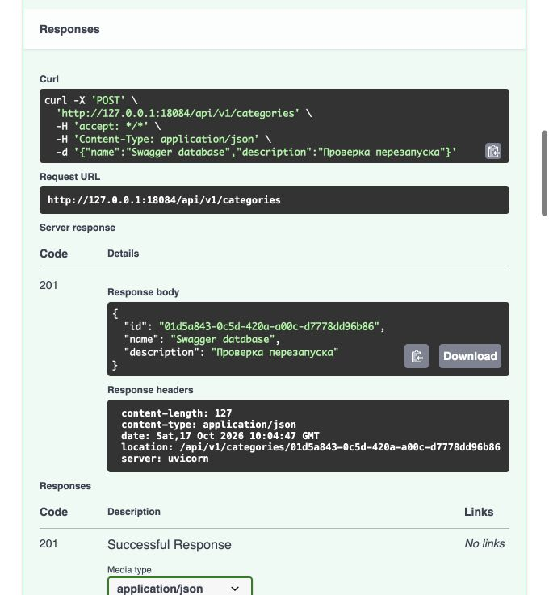

# Лабораторная работа 3. Слои, зависимости и база данных

Тема: каталог товаров. Выполнены обязательные задачи 1–6 и дополнительные 7–8.
Продвинутые задачи 9–10 не выполнялись.
[Условие](https://git.digital.mephi.ru/Backend/Project/src/commit/7d0ee186c73d8ab39677218c066f06083296df04/Part-3/README.md).

## Окружение

Проверено 17 октября 2026 года на macOS arm64, Python 3.13.16,
FastAPI 0.115.14, SQLAlchemy 2.0.55, asyncpg 0.32.0.
PostgreSQL 16 работает в Docker Compose, порт `127.0.0.1:5433`.
Версии Python-пакетов зафиксированы в `lab3/uv.lock`.
API в проверках слушает `127.0.0.1:18084`.

Команды из корня репозитория:

```bash
docker compose up -d --wait
cd lab3
uv sync --locked
uv run python -m scripts.create_schema
uv run uvicorn app.main:app --host 127.0.0.1 --port 18084
```

Ниже записаны реальные результаты. UUID меняются при повторном запуске.
HTTP-сценарии выполнялись временным проверочным скриптом через urllib;
команды curl ниже повторяют те же запросы. Подготовка и проверочные скрипты
не включены в решение; скрипты, прямо требуемые задачами 6–8, находятся в `lab3/scripts/`.

## Задачи 1 и 2. Слои и правила

Роутер вызывает один метод сценария. Сценарий использует короткие Protocol
репозиториев и получает лимит числом через конструктор. Сборка находится
в `app/dependencies/`; словари общие на процесс. Внутренние модели совпадают
с классами SQLAlchemy.

У товара два правила: уникальное название у продавца внутри категории и
остаток не больше `MAX_PRODUCT_STOCK`. Они находятся в одном методе
`ProductService._check_rules`, который вызывается из create и replace.
При replace текущий ID не участвует в поиске дубликата.
Проверки ссылок на категорию и товар также находятся в сценариях.

На памяти и на финальном PostgreSQL прошли одинаковые 46 HTTP-проверок.
Они покрывают CRUD всех сущностей, PATCH, фильтры и пагинацию,
некорректные поля, неизвестные UUID и маршруты, неподдерживаемый метод,
правила POST/PUT, запрет удаления категории и каскадное удаление отзывов.
Проверены `Location` у создания, отсутствие тела у 204 и формат ошибок.

Ниже ключевые запросы этого прогона на PostgreSQL. Тела показаны без
изменений; HTTP-заголовки, кроме статуса, здесь опущены.

### 2. POST /api/v1/categories

```bash
curl -i -X POST 'http://127.0.0.1:18084/api/v1/categories' \
  -H 'Content-Type: application/json' \
  -d '{"name": "Книги 28013016", "description": "Учебные"}'
```

```text
HTTP 201
{
  "id": "37c1fc48-2f68-4013-8fd4-69c3fa29e298",
  "name": "Книги 28013016",
  "description": "Учебные"
}
```

### 6. PATCH /api/v1/categories/37c1fc48-2f68-4013-8fd4-69c3fa29e298

```bash
curl -i -X PATCH 'http://127.0.0.1:18084/api/v1/categories/37c1fc48-2f68-4013-8fd4-69c3fa29e298' \
  -H 'Content-Type: application/json' \
  -d '{"description": null}'
```

```text
HTTP 200
{
  "id": "37c1fc48-2f68-4013-8fd4-69c3fa29e298",
  "name": "Учебники 5bb39024",
  "description": null
}
```

### 7. POST /api/v1/products

```bash
curl -i -X POST 'http://127.0.0.1:18084/api/v1/products' \
  -H 'Content-Type: application/json' \
  -d '{"category_id": "37c1fc48-2f68-4013-8fd4-69c3fa29e298", "name": "Python", "price": 1000, "stock": 1000}'
```

```text
HTTP 201
{
  "id": "549f358c-fce4-4c63-9c20-5025ecc4f795",
  "seller_id": "00000000-0000-0000-0000-000000000001",
  "category_id": "37c1fc48-2f68-4013-8fd4-69c3fa29e298",
  "name": "Python",
  "price": 1000.0,
  "discount_price": null,
  "stock": 1000,
  "condition": "new"
}
```

### 8. PUT /api/v1/products/549f358c-fce4-4c63-9c20-5025ecc4f795

```bash
curl -i -X PUT 'http://127.0.0.1:18084/api/v1/products/549f358c-fce4-4c63-9c20-5025ecc4f795' \
  -H 'Content-Type: application/json' \
  -d '{"category_id": "37c1fc48-2f68-4013-8fd4-69c3fa29e298", "name": "Python", "price": 1000, "stock": 1000}'
```

```text
HTTP 200
{
  "id": "549f358c-fce4-4c63-9c20-5025ecc4f795",
  "seller_id": "00000000-0000-0000-0000-000000000001",
  "category_id": "37c1fc48-2f68-4013-8fd4-69c3fa29e298",
  "name": "Python",
  "price": 1000.0,
  "discount_price": null,
  "stock": 1000,
  "condition": "new"
}
```

### 9. POST /api/v1/products

```bash
curl -i -X POST 'http://127.0.0.1:18084/api/v1/products' \
  -H 'Content-Type: application/json' \
  -d '{"category_id": "37c1fc48-2f68-4013-8fd4-69c3fa29e298", "name": "Python", "price": 1000, "stock": 1000}'
```

```text
HTTP 409
{
  "error": {
    "code": "conflict",
    "message": "У продавца уже есть товар с таким названием в этой категории",
    "details": [
      {
        "field": "product_id",
        "rule": "business_rule",
        "message": "549f358c-fce4-4c63-9c20-5025ecc4f795"
      }
    ]
  }
}
```

### 10. POST /api/v1/products

```bash
curl -i -X POST 'http://127.0.0.1:18084/api/v1/products' \
  -H 'Content-Type: application/json' \
  -d '{"category_id": "37c1fc48-2f68-4013-8fd4-69c3fa29e298", "name": "Другой", "price": 1000, "stock": 1001}'
```

```text
HTTP 409
{
  "error": {
    "code": "conflict",
    "message": "Остаток товара не должен превышать 1000",
    "details": [
      {
        "field": "max_product_stock",
        "rule": "business_rule",
        "message": "1000"
      }
    ]
  }
}
```

### 11. PUT /api/v1/products/549f358c-fce4-4c63-9c20-5025ecc4f795

```bash
curl -i -X PUT 'http://127.0.0.1:18084/api/v1/products/549f358c-fce4-4c63-9c20-5025ecc4f795' \
  -H 'Content-Type: application/json' \
  -d '{"category_id": "37c1fc48-2f68-4013-8fd4-69c3fa29e298", "name": "Python", "price": 1000, "stock": 1001}'
```

```text
HTTP 409
{
  "error": {
    "code": "conflict",
    "message": "Остаток товара не должен превышать 1000",
    "details": [
      {
        "field": "max_product_stock",
        "rule": "business_rule",
        "message": "1000"
      }
    ]
  }
}
```

### 12. GET /api/v1/products/549f358c-fce4-4c63-9c20-5025ecc4f795

```bash
curl -i -X GET 'http://127.0.0.1:18084/api/v1/products/549f358c-fce4-4c63-9c20-5025ecc4f795'
```

```text
HTTP 200
{
  "id": "549f358c-fce4-4c63-9c20-5025ecc4f795",
  "seller_id": "00000000-0000-0000-0000-000000000001",
  "category_id": "37c1fc48-2f68-4013-8fd4-69c3fa29e298",
  "name": "Python",
  "price": 1000.0,
  "discount_price": null,
  "stock": 1000,
  "condition": "new"
}
```

### 13. POST /api/v1/products

```bash
curl -i -X POST 'http://127.0.0.1:18084/api/v1/products' \
  -H 'Content-Type: application/json' \
  -d '{"category_id": "37c1fc48-2f68-4013-8fd4-69c3fa29e298", "name": "Другая книга", "price": 1500, "stock": 1000}'
```

```text
HTTP 201
{
  "id": "94783dcb-af8d-41cc-86d2-647d5520958b",
  "seller_id": "00000000-0000-0000-0000-000000000001",
  "category_id": "37c1fc48-2f68-4013-8fd4-69c3fa29e298",
  "name": "Другая книга",
  "price": 1500.0,
  "discount_price": null,
  "stock": 1000,
  "condition": "new"
}
```

### 14. PUT /api/v1/products/94783dcb-af8d-41cc-86d2-647d5520958b

```bash
curl -i -X PUT 'http://127.0.0.1:18084/api/v1/products/94783dcb-af8d-41cc-86d2-647d5520958b' \
  -H 'Content-Type: application/json' \
  -d '{"category_id": "37c1fc48-2f68-4013-8fd4-69c3fa29e298", "name": "Python", "price": 1000, "stock": 1000}'
```

```text
HTTP 409
{
  "error": {
    "code": "conflict",
    "message": "У продавца уже есть товар с таким названием в этой категории",
    "details": [
      {
        "field": "product_id",
        "rule": "business_rule",
        "message": "549f358c-fce4-4c63-9c20-5025ecc4f795"
      }
    ]
  }
}
```

### 15. GET /api/v1/products/94783dcb-af8d-41cc-86d2-647d5520958b

```bash
curl -i -X GET 'http://127.0.0.1:18084/api/v1/products/94783dcb-af8d-41cc-86d2-647d5520958b'
```

```text
HTTP 200
{
  "id": "94783dcb-af8d-41cc-86d2-647d5520958b",
  "seller_id": "00000000-0000-0000-0000-000000000001",
  "category_id": "37c1fc48-2f68-4013-8fd4-69c3fa29e298",
  "name": "Другая книга",
  "price": 1500.0,
  "discount_price": null,
  "stock": 1000,
  "condition": "new"
}
```

### 24. DELETE /api/v1/categories/37c1fc48-2f68-4013-8fd4-69c3fa29e298

```bash
curl -i -X DELETE 'http://127.0.0.1:18084/api/v1/categories/37c1fc48-2f68-4013-8fd4-69c3fa29e298'
```

```text
HTTP 409
{
  "error": {
    "code": "conflict",
    "message": "Нельзя удалить категорию, в которой есть товары",
    "details": [
      {
        "field": "category_id",
        "rule": "business_rule",
        "message": "37c1fc48-2f68-4013-8fd4-69c3fa29e298"
      }
    ]
  }
}
```

### 25. GET /api/v1/categories/37c1fc48-2f68-4013-8fd4-69c3fa29e298

```bash
curl -i -X GET 'http://127.0.0.1:18084/api/v1/categories/37c1fc48-2f68-4013-8fd4-69c3fa29e298'
```

```text
HTTP 200
{
  "id": "37c1fc48-2f68-4013-8fd4-69c3fa29e298",
  "name": "Учебники 5bb39024",
  "description": null
}
```

### 37. POST /api/v1/reviews

```bash
curl -i -X POST 'http://127.0.0.1:18084/api/v1/reviews' \
  -H 'Content-Type: application/json' \
  -d '{"product_id": "549f358c-fce4-4c63-9c20-5025ecc4f795", "rating": 3}'
```

```text
HTTP 201
{
  "id": "d8fc8bb3-5dcd-468e-96b5-dece9ad76bb1",
  "user_id": "00000000-0000-0000-0000-000000000001",
  "product_id": "549f358c-fce4-4c63-9c20-5025ecc4f795",
  "rating": 3,
  "text": null
}
```

### 38. DELETE /api/v1/products/549f358c-fce4-4c63-9c20-5025ecc4f795

```bash
curl -i -X DELETE 'http://127.0.0.1:18084/api/v1/products/549f358c-fce4-4c63-9c20-5025ecc4f795'
```

```text
HTTP 204
```

### 39. GET /api/v1/reviews/d8fc8bb3-5dcd-468e-96b5-dece9ad76bb1

```bash
curl -i -X GET 'http://127.0.0.1:18084/api/v1/reviews/d8fc8bb3-5dcd-468e-96b5-dece9ad76bb1'
```

```text
HTTP 404
{
  "error": {
    "code": "not_found",
    "message": "Отзыв не найден(а)",
    "details": [
      {
        "field": "id",
        "rule": "business_rule",
        "message": "d8fc8bb3-5dcd-468e-96b5-dece9ad76bb1"
      }
    ]
  }
}
```

### 40. GET /api/v1/products/549f358c-fce4-4c63-9c20-5025ecc4f795

```bash
curl -i -X GET 'http://127.0.0.1:18084/api/v1/products/549f358c-fce4-4c63-9c20-5025ecc4f795'
```

```text
HTTP 404
{
  "error": {
    "code": "not_found",
    "message": "Товар не найден(а)",
    "details": [
      {
        "field": "id",
        "rule": "business_rule",
        "message": "549f358c-fce4-4c63-9c20-5025ecc4f795"
      }
    ]
  }
}
```

### 41. DELETE /api/v1/products/94783dcb-af8d-41cc-86d2-647d5520958b

```bash
curl -i -X DELETE 'http://127.0.0.1:18084/api/v1/products/94783dcb-af8d-41cc-86d2-647d5520958b'
```

```text
HTTP 204
```

### 42. DELETE /api/v1/categories/37c1fc48-2f68-4013-8fd4-69c3fa29e298

```bash
curl -i -X DELETE 'http://127.0.0.1:18084/api/v1/categories/37c1fc48-2f68-4013-8fd4-69c3fa29e298'
```

```text
HTTP 204
```

### 43. GET /api/v1/categories/37c1fc48-2f68-4013-8fd4-69c3fa29e298

```bash
curl -i -X GET 'http://127.0.0.1:18084/api/v1/categories/37c1fc48-2f68-4013-8fd4-69c3fa29e298'
```

```text
HTTP 404
{
  "error": {
    "code": "not_found",
    "message": "Категория не найден(а)",
    "details": [
      {
        "field": "id",
        "rule": "business_rule",
        "message": "37c1fc48-2f68-4013-8fd4-69c3fa29e298"
      }
    ]
  }
}
```

## Задача 2. Перезапуск и выбор хранилища

Для `memory` приложение запущено командой:

```bash
STORAGE_BACKEND=memory uv run uvicorn app.main:app --host 127.0.0.1 --port 18084
```

В Swagger `/docs` выполнены POST → Try it out → Execute для
`/api/v1/categories` с телом:

```json
{"name":"Swagger memory","description":"Проверка перезапуска"}
```

Ответ `201`, ID `e8e2f783-d19f-42d4-893e-6ba3f29e75e8`.
После Ctrl+C и повторного запуска той же команды:

```bash
curl -i http://127.0.0.1:18084/api/v1/categories/e8e2f783-d19f-42d4-893e-6ba3f29e75e8
```

```http
HTTP/1.1 404 Not Found
date: Sat, 17 Oct 2026 10:04:10 GMT
server: uvicorn
content-length: 182
content-type: application/json

{"error":{"code":"not_found","message":"Категория не найден(а)","details":[{"field":"id","rule":"business_rule","message":"e8e2f783-d19f-42d4-893e-6ba3f29e75e8"}]}}
```

Для `database` использована та же команда без `STORAGE_BACKEND=memory`:
база выбрана по умолчанию. В Swagger создана категория:

```json
{"name":"Swagger database","description":"Проверка перезапуска"}
```

Ответ `201`, ID `01d5a843-0c5d-420a-a00c-d7778dd96b86`.



После Ctrl+C и повторного запуска приложения:

```bash
curl -i http://127.0.0.1:18084/api/v1/categories/01d5a843-0c5d-420a-a00c-d7778dd96b86
```

```http
HTTP/1.1 200 OK
date: Sat, 17 Oct 2026 10:05:08 GMT
server: uvicorn
content-length: 127
content-type: application/json

{"id":"01d5a843-0c5d-420a-a00c-d7778dd96b86","name":"Swagger database","description":"Проверка перезапуска"}
```

Код сценариев и роутеров между этими запусками не менялся.

## Задача 3. Проверка конфигурации

Параметры и диапазоны перечислены в [README](../lab3/README.md#конфигурация).
Проверены четыре запуска с неверными значениями:

```bash
MAX_PRODUCT_STOCK=-1 uv run uvicorn app.main:app --port 18085
MAX_PRODUCT_STOCK=abc uv run uvicorn app.main:app --port 18085
MAX_PRODUCT_STOCK=1000001 uv run uvicorn app.main:app --port 18085
STORAGE_BACKEND=file uv run uvicorn app.main:app --port 18085
```

Все завершились с кодом 1 до сообщения об успешном старте приложения.
Фрагменты ошибок с именем поля:

```text
MAX_PRODUCT_STOCK=-1: exit=1
pydantic_core._pydantic_core.ValidationError: 1 validation error for Settings
max_product_stock
  Input should be greater than or equal to 1 [type=greater_than_equal, input_value='-1', input_type=str]
    For further information visit https://errors.pydantic.dev/2.14/v/greater_than_equal

MAX_PRODUCT_STOCK=abc: exit=1
pydantic_core._pydantic_core.ValidationError: 1 validation error for Settings
max_product_stock
  Input should be a valid integer, unable to parse string as an integer [type=int_parsing, input_value='abc', input_type=str]
    For further information visit https://errors.pydantic.dev/2.14/v/int_parsing

MAX_PRODUCT_STOCK=1000001: exit=1
pydantic_core._pydantic_core.ValidationError: 1 validation error for Settings
max_product_stock
  Input should be less than or equal to 1000000 [type=less_than_equal, input_value='1000001', input_type=str]
    For further information visit https://errors.pydantic.dev/2.14/v/less_than_equal

STORAGE_BACKEND=file: exit=1
pydantic_core._pydantic_core.ValidationError: 1 validation error for Settings
storage_backend
  Input should be 'memory' or 'database' [type=literal_error, input_value='file', input_type=str]
    For further information visit https://errors.pydantic.dev/2.14/v/literal_error
```

## Задачи 4 и 5. Схема, сессия и транзакция

Три таблицы описаны через `Mapped` и `mapped_column`; ключи — UUID.
Внешние ключи: `products.category_id → categories.id` и
`reviews.product_id → products.id`. Связи ORM двусторонние.
`Base` включает `AsyncAttrs` для демонстрации задачи 8.
Движок и фабрика сессий создаются один раз в `app/core/database.py`.
`created_at` задаёт порядок создания в списках и не входит в HTTP-ответы.

```bash
uv run python -m scripts.create_schema
# Таблицы созданы, существующие сохранены
uv run python -m scripts.create_schema --recreate
# Таблицы пересозданы
```

`create_all` существующие таблицы не меняет. Вторую команду выполняли после
изменения `ondelete`, когда в учебной базе не было нужных данных.

Переход на PostgreSQL сделан отдельным коммитом `09d48dd` после `d2bd9e1`.
Следующая команда не выводит различий: сценарии и роутеры при подключении БД не менялись.

```bash
git diff d2bd9e1 09d48dd -- lab3/app/use_cases lab3/app/routers
```

Репозитории получают общую сессию запроса, изменяют объекты и делают `flush`.
Зависимость `get_session` управляет `session.begin()`: успех фиксируется,
исключение выходит наружу и откатывает транзакцию.

Дополнительно временной ASGI-проверкой проверен момент отправки ответа:
другая сессия читала БД прямо при `http.response.start`. Первый случай использовал
обычный POST категории. Во втором проверочный обработчик выполнил INSERT и flush,
затем поднял 409. В третьем удаление через реальный репозиторий нарушило FK.
Проверочные маршруты в приложение не добавлены.

```text
/api/v1/categories: HTTP 201, до отправки ответа другая сессия видит 1 строк
/probe-rollback: HTTP 409, до отправки ответа другая сессия видит 0 строк
/probe-fk: HTTP 409, до отправки ответа другая сессия видит 1 строк
Ответ на нарушение FK: {"error":{"code":"conflict","message":"Операция запрещена: объект связан с другими записями","details":[]}}
```

## Задача 6. SQL-инъекция

```bash
uv run python -m scripts.sql_injection
```

Скрипт создаёт четыре товара у собственного продавца. Это позволяет показать
инъекцию на своих данных; после работы транзакция откатывается.

```text

Поиск по имени 'Телефон':
  search_unsafe: ['Телефон']
  search_bound: ['Телефон']
  search_orm: ['Телефон']

Поиск по имени "' OR '1'='1":
  search_unsafe: ['Кабель_USB', 'Наушники', 'Скидка 10%', 'Телефон']
  search_bound: []
  search_orm: []

ILIKE, фрагмент 'Тел':
  SQL до: SELECT products.name FROM products WHERE products.seller_id = $1::UUID AND products.name ILIKE $2::VARCHAR ORDER BY products.name
  Шаблон '%Тел%': ['Телефон']
  SQL после: SELECT products.name FROM products WHERE products.seller_id = $1::UUID AND products.name ILIKE $2::VARCHAR ESCAPE '\' ORDER BY products.name
  Шаблон '%Тел%': ['Телефон']

ILIKE, фрагмент "' OR '1'='1":
  SQL до: SELECT products.name FROM products WHERE products.seller_id = $1::UUID AND products.name ILIKE $2::VARCHAR ORDER BY products.name
  Шаблон "%' OR '1'='1%": []
  SQL после: SELECT products.name FROM products WHERE products.seller_id = $1::UUID AND products.name ILIKE $2::VARCHAR ESCAPE '\' ORDER BY products.name
  Шаблон "%' OR '1'='1%": []

ILIKE, фрагмент '%':
  SQL до: SELECT products.name FROM products WHERE products.seller_id = $1::UUID AND products.name ILIKE $2::VARCHAR ORDER BY products.name
  Шаблон '%%%': ['Кабель_USB', 'Наушники', 'Скидка 10%', 'Телефон']
  SQL после: SELECT products.name FROM products WHERE products.seller_id = $1::UUID AND products.name ILIKE $2::VARCHAR ESCAPE '\' ORDER BY products.name
  Шаблон '%\\%%': ['Скидка 10%']

ILIKE, фрагмент '_':
  SQL до: SELECT products.name FROM products WHERE products.seller_id = $1::UUID AND products.name ILIKE $2::VARCHAR ORDER BY products.name
  Шаблон '%_%': ['Кабель_USB', 'Наушники', 'Скидка 10%', 'Телефон']
  SQL после: SELECT products.name FROM products WHERE products.seller_id = $1::UUID AND products.name ILIKE $2::VARCHAR ESCAPE '\' ORDER BY products.name
  Шаблон '%\\_%': ['Кабель_USB']

Учебные данные удалены откатом транзакции.
```

При обычном имени все три способа нашли «Телефон». В первом способе строка
попала прямо в текст SQL: условие `name = '' OR '1'='1'` истинно для всех
четырёх учебных товаров. Во втором способе текст SQL содержит параметр,
а строка с кавычками передаётся отдельно как его значение. База ищет название,
буквально равное этой строке. Третий способ строит выражение SQLAlchemy,
которое тоже превращается в SQL с отдельным параметром. Поэтому во втором
и третьем случаях результат пустой: такого названия нет.

В API нет поиска по подстроке, поэтому ILIKE показан в скрипте.
Параметризация защищает структуру SQL, но `%` и `_` остаются символами шаблона.
Без экранирования оба ввода нашли все четыре непустых имени. После замены
обратной косой черты, `%` и `_` и указания `ESCAPE` ищутся буквальные символы:
найдены только «Скидка 10%» и «Кабель_USB» соответственно.

## Задача 7. Запрет удаления и два каскада

Категория с товарами удаляться не должна: возвращается `409` с объяснением.
На БД действует `ON DELETE RESTRICT`; `passive_deletes="all"` не даёт ORM
записать NULL в `category_id`. В памяти запрет проверяет тот же сценарий.
Нарушение FK из базы также переводится в безопасный `409` обработчиком ошибок.

Отзывы без товара не нужны и удаляются вместе с ним. Сначала на коммите
`09d48dd` использовались `cascade="all, delete-orphan"`, `passive_deletes=False`
и FK без `ondelete`. Выполнена команда:

```bash
uv run python -m scripts.cascade_delete --mode orm
```

```text
Режим: orm; отзывов до удаления: 3
SQL удаления:
  SELECT products.id AS products_id, products.seller_id AS products_seller_id, products.category_id AS products_category_id, products.name AS products_name, products.price AS products_price, products.discount_price AS products_discount_price, products.stock AS products_stock, products.condition AS products_condition, products.created_at AS products_created_at FROM products WHERE products.id = $1::UUID
  SELECT reviews.id AS reviews_id, reviews.user_id AS reviews_user_id, reviews.product_id AS reviews_product_id, reviews.rating AS reviews_rating, reviews.text AS reviews_text, reviews.created_at AS reviews_created_at FROM reviews WHERE $1::UUID = reviews.product_id
  DELETE FROM reviews WHERE reviews.id = $1::UUID
  DELETE FROM products WHERE products.id = $1::UUID
Товаров после удаления: 0
Отзывов после удаления: 0
Учебные данные удалены откатом транзакции.
```

ORM прочитала отзывы и отправила DELETE для них, затем DELETE товара.
Удаление трёх отзывов отправлено одним вызовом executemany; в логе слушателя
этот вызов показан одной строкой DELETE.

Затем у FK отзывов установлен `ondelete="CASCADE"`, у связи товара —
`passive_deletes=True`. После пересоздания таблиц:

```bash
uv run python -m scripts.create_schema --recreate
uv run python -m scripts.cascade_delete --mode database
```

```text
Режим: database; отзывов до удаления: 3
SQL удаления:
  SELECT products.id AS products_id, products.seller_id AS products_seller_id, products.category_id AS products_category_id, products.name AS products_name, products.price AS products_price, products.discount_price AS products_discount_price, products.stock AS products_stock, products.condition AS products_condition, products.created_at AS products_created_at FROM products WHERE products.id = $1::UUID
  DELETE FROM products WHERE products.id = $1::UUID
Товаров после удаления: 0
Отзывов после удаления: 0
Учебные данные удалены откатом транзакции.
```

Коллекция отзывов заранее не загружалась. Приложение отправило только DELETE
товара, а три отзыва удалила сама база. В обоих случаях после удаления
осталось ноль товаров и ноль отзывов этого примера. Учебные данные скрипта
затем удалены откатом общей транзакции.

## Задача 8. N+1

Операция демонстрации — вывести список товаров с названием категории.
Созданы три товара в трёх разных категориях; каждый способ использует
свежую сессию, чтобы кэш объектов не скрывал обращения к БД.
Слушатель `before_cursor_execute` подключён только на время измерения.

```bash
uv run python -m scripts.n_plus_one
```

```text

direct:
  MissingGreenlet: обычный атрибут не может ожидать SQL.
  Вызовов before_cursor_execute: 2
  SELECT products.id, products.seller_id, products.category_id, products.name, products.price, products.discount_price, products.stock, products.condition, products.created_at FROM products WHERE products.id IN ($1::UUID, $2::UUID, $3::UUID) ORDER BY products.name
  SELECT categories.id AS categories_id, categories.name AS categories_name, categories.description AS categories_description, categories.created_at AS categories_created_at FROM categories WHERE categories.id = $1::UUID
  Последний SELECT связи прерван до выполнения: нужен await.

awaitable_attrs:
  Товар N+1 1: Категория N+1 1
  Товар N+1 2: Категория N+1 2
  Товар N+1 3: Категория N+1 3
  Вызовов before_cursor_execute: 4
  SELECT products.id, products.seller_id, products.category_id, products.name, products.price, products.discount_price, products.stock, products.condition, products.created_at FROM products WHERE products.id IN ($1::UUID, $2::UUID, $3::UUID) ORDER BY products.name
  SELECT categories.id AS categories_id, categories.name AS categories_name, categories.description AS categories_description, categories.created_at AS categories_created_at FROM categories WHERE categories.id = $1::UUID
  SELECT categories.id AS categories_id, categories.name AS categories_name, categories.description AS categories_description, categories.created_at AS categories_created_at FROM categories WHERE categories.id = $1::UUID
  SELECT categories.id AS categories_id, categories.name AS categories_name, categories.description AS categories_description, categories.created_at AS categories_created_at FROM categories WHERE categories.id = $1::UUID

selectinload:
  Товар N+1 1: Категория N+1 1
  Товар N+1 2: Категория N+1 2
  Товар N+1 3: Категория N+1 3
  Вызовов before_cursor_execute: 2
  SELECT products.id, products.seller_id, products.category_id, products.name, products.price, products.discount_price, products.stock, products.condition, products.created_at FROM products WHERE products.id IN ($1::UUID, $2::UUID, $3::UUID) ORDER BY products.name
  SELECT categories.id AS categories_id, categories.name AS categories_name, categories.description AS categories_description, categories.created_at AS categories_created_at FROM categories WHERE categories.id IN ($1::UUID, $2::UUID, $3::UUID)

joinedload:
  Товар N+1 1: Категория N+1 1
  Товар N+1 2: Категория N+1 2
  Товар N+1 3: Категория N+1 3
  Вызовов before_cursor_execute: 1
  SELECT products.id, products.seller_id, products.category_id, products.name, products.price, products.discount_price, products.stock, products.condition, products.created_at, categories_1.id AS id_1, categories_1.name AS name_1, categories_1.description, categories_1.created_at AS created_at_1 FROM products LEFT OUTER JOIN categories AS categories_1 ON categories_1.id = products.category_id WHERE products.id IN ($1::UUID, $2::UUID, $3::UUID) ORDER BY products.name

Учебные данные удалены откатом транзакции.
```

| Способ | Результат |
|---|---|
| Прямой `product.category` | `MissingGreenlet`: одна выполненная выборка товаров и одна прерванная попытка загрузки категории; слушатель сработал дважды |
| `await product.awaitable_attrs.category` | 4 запроса: один за товарами и по одному на каждую из трёх категорий |
| `selectinload` | 2 запроса: товары, затем все нужные категории через IN |
| `joinedload` | 1 запрос с LEFT OUTER JOIN |

Прямой доступ не может незаметно сделать асинхронный запрос — поэтому получена
ошибка, а не готовый список. `awaitable_attrs` разрешает ожидание, но оставляет
N+1. `selectinload` и `joinedload` загружают связь явно и сокращают число запросов.

## Проверка кода и сдача

```bash
uv run ruff check app scripts
# All checks passed!
uv run ruff format --check app scripts
# 41 files already formatted
```

Ветка `lab-03` предназначена для GitHub `origin`. Первая и вторая лабораторные
не изменены. В `git_digital` работа не отправлялась. Слияние и тег
`lab-03-v1.0` выполняются отдельно; тег по условию ставится после слияния.
